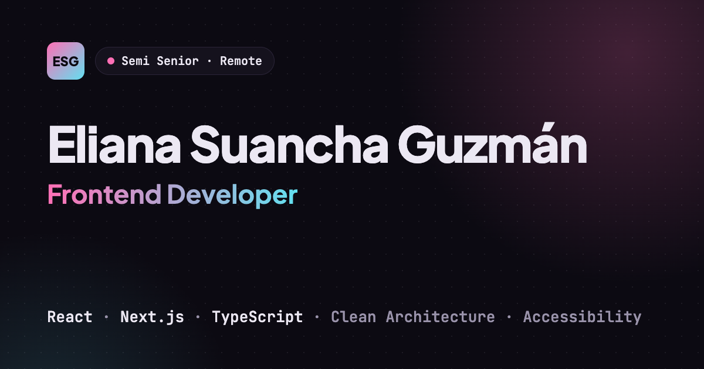

# Eliana Suancha Guzmán · Portfolio

Personal portfolio of a Semi Senior Frontend Developer. A bilingual (Spanish / English) one-page site that presents my experience, selected projects and the way I build software.



## Highlights

- **Interactive terminal** in the hero: visitors can type commands like `whoami`, `stack` or `contact`.
- **Bilingual routing** with `/es` and `/en`, statically generated, plus automatic language detection from the browser.
- **Accessible by design:** semantic HTML, keyboard navigation, visible focus states, WCAG AA color contrast and `prefers-reduced-motion` support.
- **Performance:** static rendering, optimized images with `next/image` and self-hosted fonts with `next/font`.
- **Type-safe translations:** every dictionary is typed against the Spanish one, so the build fails if a translation is missing.

## Tech stack

| Area | Technology |
|---|---|
| Framework | Next.js 16 (App Router), React 19 |
| Language | TypeScript (strict) |
| Styling | Tailwind CSS 4 with design tokens in `@theme` |
| Animation | Motion |
| Quality | ESLint, TypeScript type checking |
| CI | GitHub Actions |

## Architecture

The UI follows **Atomic Design**, and content is kept separate from components:

```
src/
├── app/[lang]/        # Routes, root layout and metadata per locale
├── components/
│   ├── atoms/         # Smallest building blocks: Tag, ButtonLink, StatusPill…
│   ├── molecules/     # Combinations of atoms: ProjectCard, SectionHeader…
│   └── organisms/     # Page sections: Hero, Projects, Contact…
├── content/           # Profile data, projects, experience and typed dictionaries
├── hooks/             # Client-side behavior: terminal, pointer glow, dot grid
├── lib/               # i18n helpers and formatting utilities
├── types/             # Shared domain types
└── proxy.ts           # Redirects to the preferred locale
```

Components receive already translated content as props, so they stay free of language logic and easy to reuse.

## Getting started

Requirements: Node.js 20.9 or later.

```bash
npm install
npm run dev
```

Open [http://localhost:3000](http://localhost:3000). You will be redirected to `/es` or `/en` depending on your browser language.

## Scripts

| Command | Description |
|---|---|
| `npm run dev` | Start the development server |
| `npm run build` | Create a production build |
| `npm run start` | Serve the production build |
| `npm run lint` | Run ESLint |
| `npm run typecheck` | Generate Next.js route types and run the TypeScript compiler |

## Workflow

Development follows **GitHub Flow**:

1. Every change starts as an issue.
2. Work happens on a short-lived branch (`feat/…`, `chore/…`, `ci/…`).
3. A pull request closes the issue and is merged with **squash and merge**.

The `main` branch is protected by a ruleset: changes require a pull request, and the **CI workflow** (lint, type check and build) must pass before merging.

## Contact

- Email: [elianitasuanguz@gmail.com](mailto:elianitasuanguz@gmail.com)
- LinkedIn: [linkedin.com/in/elianaguz](https://www.linkedin.com/in/elianaguz)
- GitHub: [github.com/elianisdev](https://github.com/elianisdev)
